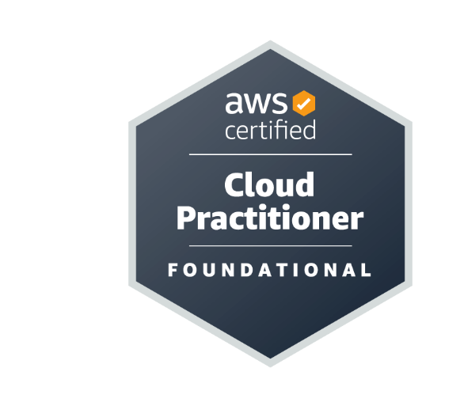
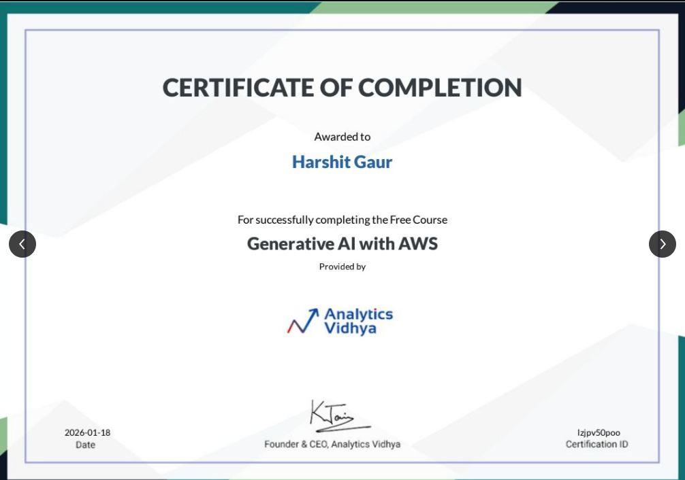
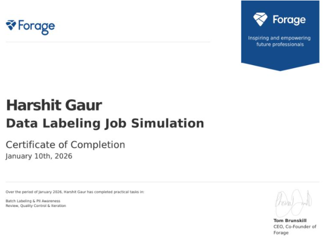
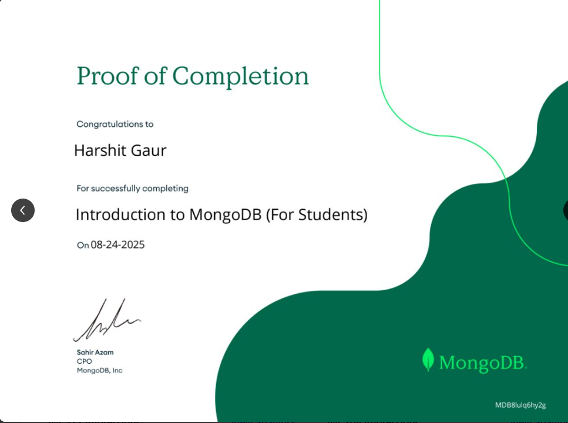
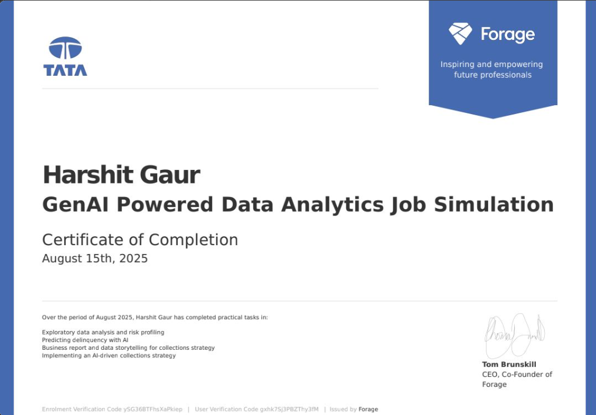
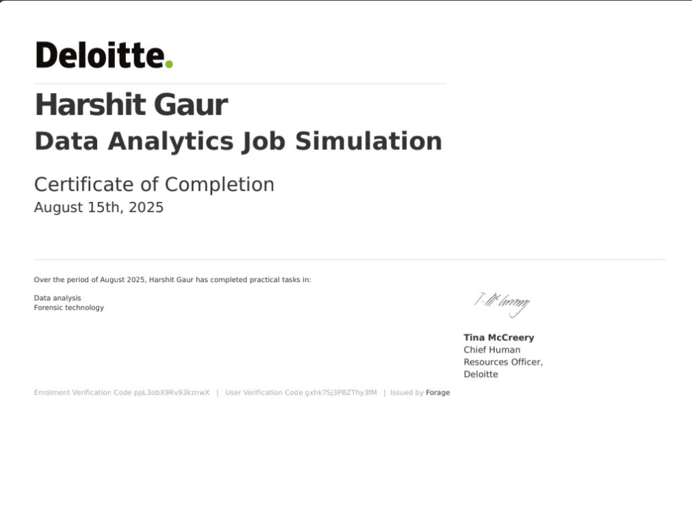
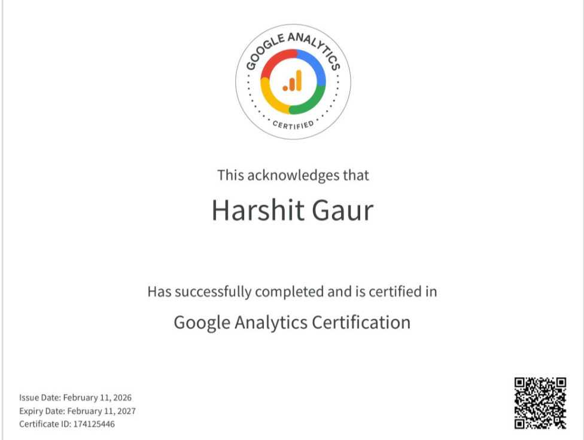

<!-- Dynamic Typing Headline -->

 

### 👋 Hi there, I'm Harshit Gaur

I am a **final-year Computer Science Engineering student specializing in Data Science**, driven by systematic execution and a passion for technology-driven solutions. My work bridges the gap between scalable cloud infrastructure, machine learning, and actionable business intelligence. 

When I'm not building end-to-end data pipelines, I am exploring AI workflows and developing machine learning models.

---

### 🚀 What I'm Doing Right Now
- 📊 **Data Analytics & BI:** Building data pipelines, performing EDA, and translating complex data into actionable business insights using Python, SQL, and Power BI.
- ☁️ **Cloud Computing:** Architecting scalable solutions and applying my knowledge as an **AWS Certified Cloud Practitioner**.
- 🧠 **Machine Learning:** Developing NLP classification models and integrating AI-powered workflows into user-facing web applications.

 

### 💻 Featured Projects

#### 🧾 [Invoice Extraction API](https://github.com/HarshitGaur08/invoice-extraction-api)
An AI-powered document processing API that extracts vendor, invoice number, dates, currency, subtotal, tax, and total from invoice images and PDFs. Includes bounded upload and PDF handling, structured response validation, health checks, and Docker support.

**Stack:** Python · FastAPI · PyTorch · Hugging Face Transformers · Docker

#### 📚 [Distributed RAG System](https://github.com/HarshitGaur08/distributed-rag)
A document Q&A system that ingests PDF, Markdown, and text files, stores source documents through a local/S3-compatible storage adapter, indexes chunks in ChromaDB, and answers questions with retrieved context and source citations. Includes a query API and Kubernetes deployment manifests.

**Stack:** Python · FastAPI · LangChain · Hugging Face · ChromaDB · AWS S3/boto3 · Kubernetes

#### 📈 [Algorithmic Trading Backtester](https://github.com/HarshitGaur08/trading-backtester)
A vectorized moving-average strategy backtester with next-bar signal execution, configurable transaction costs, and return/risk metrics. A REST API submits backtests as asynchronous jobs, persists job state in SQLite, and processes work with a bounded worker pool.

**Stack:** Python · NumPy · Pandas · FastAPI · SQLite · Docker

 

### 🛠️ Tech Stack & Tools

**Data Analytics, BI & Databases** 

**Cloud & Web Tools** 

**AI / Machine Learning** 

 

### 🧩 Other Projects
- 📰 **Fake News Detector:** Developed a web-based machine learning application to classify news content as fake or genuine, using Python for backend logic and achieving 65%+ NLP classification accuracy.
- 🎨 **AI-Powered Text-to-Image Generator:** Created an end-to-end web application that generates images from text prompts using an AI-powered workflow, integrating Python backend logic with a structured frontend interface.
- 📈 **Business Data Analytics Pipeline:** Performed comprehensive data cleaning and exploratory data analysis to identify actionable insights, utilizing SQL, Excel, and Power BI for interactive reporting and business-oriented dashboard views.

 

### 🏆 Certifications & Milestones
- ☁️ **AWS Certified Cloud Practitioner (CLF-C02)** - Amazon Web Services (2026)_https://www.credly.com/badges/3cc02390-3dd0-42f2-a89a-eb9fdfbc570e.
- 💼 **Industry Job Simulations:** Selected and completed virtual Data Analytics and GenAI job simulations powered by Deloitte and Tata (Forage).

 

### 📊 GitHub Analytics

  
  

 

### 📈 Activity Graph

  

---

  <i>"Transforming data into actionable intelligence."</i>

### 🏆 Certifications & Milestones
- ☁️ **AWS Certified Cloud Practitioner (CLF-C02)** - Amazon Web Services (2026)_https://www.credly.com/badges/3cc02390-3dd0-42f2-a89a-eb9fdfbc570e.
- 💼 **Industry Job Simulations:** Selected and completed virtual Data Analytics and GenAI job simulations powered by Deloitte and Tata (Forage).

 

**Certificate Gallery**

  
  
  
    
  
  
  
  

