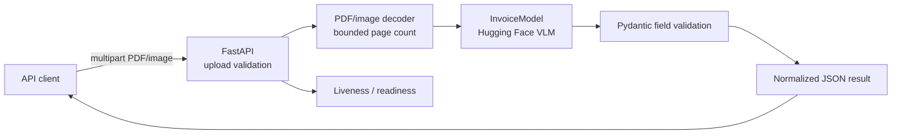

# Invoice Extraction API

A FastAPI microservice that accepts invoice images or PDFs, runs a Hugging Face
vision-language model, validates the extracted fields, and returns a normalized
JSON response. This project focuses on document AI and API operations; it does
not connect to external business systems or persist uploaded invoices.

## Architecture



## Project layout

```text
invoice-extraction-api/
├── app/
│   ├── __init__.py
│   ├── main.py           # FastAPI routes, upload validation, response models
│   └── ml_model.py       # Hugging Face model loading and inference
├── tests/
│   └── test_api.py
├── .dockerignore
├── .gitignore
├── Dockerfile
├── requirements.txt
└── requirements-dev.txt
```

## Requirements and setup

- Python 3.11+
- The model requires a supported PyTorch environment. CPU inference works but
  can be slow; for production, use a GPU-enabled image/runtime and provision
  sufficient memory for the selected model.
- The first start downloads the model from Hugging Face. Provide network access
  or pre-populate the Hugging Face cache in your deployment environment.

```powershell
cd projects/invoice-extraction-api
py -3.11 -m venv .venv
.\.venv\Scripts\Activate.ps1
python -m pip install -r requirements.txt
$env:HF_MODEL_ID = "Qwen/Qwen2.5-VL-3B-Instruct"
uvicorn app.main:app --host 0.0.0.0 --port 8000
```

Configuration:

| Variable | Default | Description |
|---|---|---|
| `HF_MODEL_ID` | `Qwen/Qwen2.5-VL-3B-Instruct` | Hugging Face vision-language model ID |
| `MAX_UPLOAD_BYTES` | `15728640` | Maximum upload size (15 MiB) |
| `MAX_PDF_PAGES` | `8` | Maximum pages rasterized per PDF |
| `LOG_LEVEL` | `INFO` | Python logging level |

## API

### `POST /api/v1/invoices/extract`

Send a PDF, PNG, or JPEG as the `file` multipart field. Uploads are limited to
15 MiB by default, and PDFs are limited to eight pages.

```powershell
curl.exe -X POST http://localhost:8000/api/v1/invoices/extract `
  -F "file=@invoice.pdf;type=application/pdf"
```

Successful response (fields the model cannot read or determine are `null`):

```json
{
  "invoice": {
    "document_id": "f378bf63-0135-4afe-b95e-a949ff5e3a79",
    "vendor": "Example Supplies Ltd.",
    "invoice_number": "INV-2026-1042",
    "invoice_date": "2026-10-10",
    "currency": "USD",
    "amount": 100.0,
    "tax_amount": 8.0,
    "total_amount": 108.0,
    "page_count": 1,
    "extraction_status": "EXTRACTED"
  }
}
```

`amount` is the pre-tax amount; `tax_amount` is the tax amount;
`total_amount` is the amount due. `extraction_status` is `PARTIAL` when one or
more of the vendor, amount, tax, or total fields are missing. Review and
validate extracted values before using them in downstream workflows.

| Method | Path | Purpose |
|---|---|---|
| `GET` | `/health/live` | Process liveness |
| `GET` | `/health/ready` | Returns 200 only after the model has loaded |
| `GET` | `/docs` | Interactive OpenAPI documentation |

Common errors use standard HTTP status codes: `413` for oversized uploads,
`422` for unsupported or invalid documents, and `502` when inference or
structured model output fails. Responses include a request identifier on
inference failures; logs do not include invoice contents or extracted values.

## Docker

```powershell
docker build -t invoice-extraction-api .
docker run --rm -p 8000:8000 `
  -v invoice-hf-cache:/home/app/.cache/huggingface `
  invoice-extraction-api
```

The image runs as a non-root user. The model weights are downloaded on startup
and cached in the mounted Hugging Face cache. Use an appropriately sized host
or GPU-enabled runtime for the selected model.

## Tests

```powershell
python -m pip install -r requirements-dev.txt
python -m pytest -q
```
